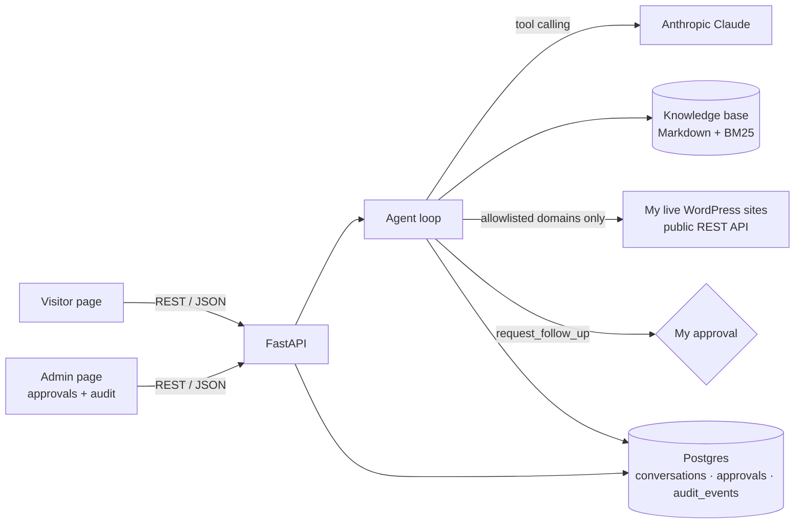

# Interview my agent

**Don't read my CV. Interview my agent.**

An AI agent that answers questions about me, Dionysios Kyriakongonas, from my CV, my projects and notes I wrote. It searches what I've written, checks my live client sites in real time, says when it doesn't know, and asks for my approval before it commits me to anything. Every step is recorded in an audit log.

I built it with Claude as my coding assistant, to show the kind of system I want to work on: agents with tools, a human in the loop, and an audit trail.

## What it does

| Tool | Policy | What it does |
|---|---|---|
| `search_profile` | auto | BM25 search over my CV, projects, way of working and fit for the role |
| `list_projects` | auto | Lists my 10 live projects |
| `check_live_site` | auto | Calls the public WordPress REST API of one of my sites right now: response time, pages, products, whether its MCP endpoint is live, and the custom REST endpoints I built |
| `request_follow_up` | **requires my approval** | A visitor asks for a call or meeting; the conversation pauses until I approve or decline |

## Architecture



- **The model proposes, the code decides.** The LLM only returns a tool name and JSON arguments. My code validates them with Pydantic, applies the tool policy, and runs the tool.
- **Human-in-the-loop.** Tools that act on someone's behalf need approval. The conversation is checkpointed in Postgres after every step, so it can wait for hours and survive a restart.
- **Audit log.** Append-only events for every visitor message, model call (with token counts), tool call and human decision, written in the same transaction as the change they describe.
- **Guardrails.** Allowlist for outgoing requests (no arbitrary URLs), step limit per message, message limit per conversation, tool output treated as data rather than instructions, no personal data of my clients' users, LLM text rendered as escaped text in the browser, admin endpoints behind a token when `ADMIN_TOKEN` is set.

## Run it

Requirements: Docker Desktop and an Anthropic API key.

```bash
cp .env.example .env        # Windows: copy .env.example .env
# put your ANTHROPIC_API_KEY in .env
docker compose up --build
```

- **http://localhost:8000**: the visitor page
- **http://localhost:8000/admin**: approvals, conversations and the audit log
- **http://localhost:8000/docs**: interactive API docs (Swagger)

`LLM_MODE=fake` runs everything offline with a scripted model (used by the tests, and as a demo backup).

## API

| Method | Endpoint | |
|---|---|---|
| `POST` | `/conversations` | Start a conversation (`201`) |
| `POST` | `/conversations/{id}/messages` | Ask a follow-up question (`202`, `409` while the agent is busy) |
| `GET` | `/conversations/{id}` | Status and transcript |
| `GET` | `/api/projects` | Public list of projects |
| `GET` | `/conversations/{id}/audit` | Audit trail *(admin)* |
| `GET` | `/approvals` | Pending approvals *(admin)* |
| `POST` | `/approvals/{id}/approve` · `/reject` | Decide (`409` if already decided) *(admin)* |

## Tests

```bash
pip install -r requirements-dev.txt
pytest
```

End-to-end tests with the scripted model: answers from the knowledge base, multi-turn conversations, approval and rejection, `409` while waiting, admin token, domain allowlist, input validation and retrieval quality.

## What I'd add next

- **pgvector** embeddings instead of BM25 once the knowledge base grows.
- **Evals** in CI: a golden set of interview questions checking tool choice, grounding and honesty.
- **OpenTelemetry** tracing across API, agent, model and tools.
- A real job queue and workers instead of in-process background tasks; Alembic migrations.
- Exposing the same tools as an **MCP server**, so you could add "me" to your own Claude.
- Actually delivering approved follow-ups by email.

## Project structure

```
app/
  main.py        FastAPI endpoints and schemas
  agent.py       Agent loop, approvals, resume logic, system prompt
  tools.py       Tool definitions, policy, validation, live-site check
  knowledge.py   Knowledge base loader and BM25 search
  db.py          SQLAlchemy models
  audit.py       Audit helpers
  fake_llm.py    Scripted model for tests and offline demos
  static/        Visitor page, admin page, my CV
knowledge/       What the agent knows about me (Markdown + projects.json)
tests/
```

## Contact

gogosdion@gmail.com · [linkedin.com/in/dionysios-kyriakongonas](https://linkedin.com/in/dionysios-kyriakongonas) · [gowebgo.gr](https://gowebgo.gr)
